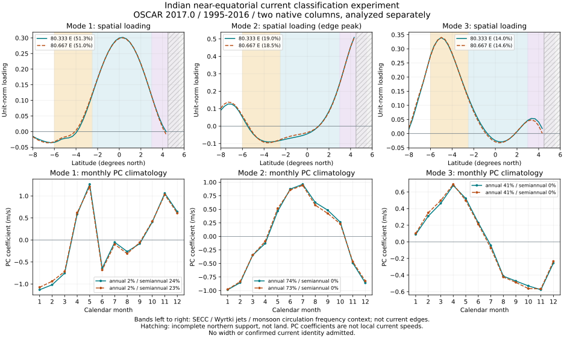

# Indian countercurrent: reproducible classification experiment

## Result and remaining measurement gap

This experiment advances the mode-interference investigation for the Indian
South Equatorial Countercurrent. It does **not** admit a physical width,
current identity, seasonal envelope, annual extrema or whole-current length.
The 149 scoped width records across 79 inventory names remain unchanged.

The two native OSCAR columns produce similar leading statistical patterns
over 1995–2016. The southern third pattern peaks near 5°S and its principal
component climatology peaks in April. Across all 15 comparisons of six fits,
the first three patterns match the same ranks. For the southern pattern, the
smallest common-support loading cosine is 0.9527134461 and the smallest
loading-aligned PC correlation is 0.9467523737. These are sensitivity results
within the same product, not independent validation or confidence intervals.

Five northern latitudes fail the complete monthly-support rule: 4⅔, 5, 5⅓,
5⅔ and 6°N. They are excluded, never filled or classified as land. The second
pattern peaks at the retained northern edge, 4⅓°N. Its northern extent is
unresolved; the comparison cannot validate the complete monsoon-current shape.

## Source and prospective choices

The primary context is [Huang et al. (2023)](https://agupubs.onlinelibrary.wiley.com/doi/full/10.1029/2022JC019147),
doi:10.1029/2022JC019147. The publisher methods and relevant figure captions
were read; original paper figures, author code and fitted fields were not
acquired. The source's reported variance percentages supply context only.
The exact author domain and weighting are unavailable, so this is an OSW
experiment, not an exact reproduction.

The [original preflight](../research/source-data/oscar-indian-eof-1995-2016/preflight.json)
was frozen before acquisition of the northern data. Its SHA256 is
`b9c19d3c1abd87bf9b1c03910d383905a07de73ba2a957f597f83ab1224587a9`.
It declares the primary latitude window −8 to 6°N and sensitivity windows
−6 to 6 and −10 to 6°N. Each native longitude, 80⅓ and 80⅔°E, is fitted
separately; no fictitious observed 80.5°E section is introduced.

Data are OSCAR 2017.0, NOAA PIFSC ERDDAP dataset `yearly_336c_0b32_9cd3`,
provided by ESR/Kathleen Dohan. The metadata permit free use and redistribution.
The retained product citation is Bonjean and Lagerloef (2002), J. Phys.
Oceanogr. 32, 2938–2954. Nominal depth is 15 m; the product represents
near-surface flow, rather than direct observations at that exact depth.
Both eastward and northward components, units, grids, metadata and source
checksums are checked. Only eastward monthly anomalies enter the EOF fit.

New northern CSV originals cover 0–6°N. Their [acquisition receipt](../research/source-data/oscar-indian-eof-1995-2016/acquisition.json)
retains the original URLs, returned bytes, hashes and acquisition time.
The historical receipt's parse-pending status is preserved; the completed
parse and overlap checks are recorded in the derived experiment and tests.
The previously retained southern originals cover 12°S–0°.
All 1,585 overlapping equatorial records per column match both components
and missingness exactly. The returned 2017-01-01 record is preserved in the
originals and excluded from the analysis. No timestamp is moved.

## Fixed calculation and follow-up comparison

1. Form equal-record monthly means of complete u/v pairs. Require at least
   five pairs per month; all 264 calendar months must be supported at a
   retained latitude. Drop deficient latitudes from the fit without filling.
2. Subtract each latitude's 264-month temporal mean, retaining the seasonal
   cycle. Apply unweighted, unstandardized covariance SVD. Store unit-norm
   spatial vectors and PC coefficients as left singular vectors times
   singular values. Orient the largest absolute spatial loading positively.
   Signs have no independent physical flow-direction meaning.
3. Report five modes, loading peaks, annual/semiannual PC harmonics and
   source-context-band loading energy. Shared band endpoints belong to the
   Wyrtki-jet context only, avoiding double counting. These are classification
   regions, not velocity boundaries. Mode rank alone never assigns a name.
4. After inspecting the primary fits, add an explicitly exploratory comparison
   across **all 15 pairs** of the six fits. Restrict loadings to common sampled
   latitudes and normalize there. Maximize total absolute loading cosine with
   a one-to-one assignment of the source's first three to all five target
   modes. Preserve signed temporal correlation after loading-sign alignment;
   also report first-three-subspace principal angles. No acceptance cutoff is
   chosen. This follow-up was not part of the original prospective preflight.

| Native column | Primary variance, modes 1 / 2 / 3 |
|---|---|
| 80⅓°E | 51.2588% / 19.0124% / 13.9672% |
| 80⅔°E | 51.0294% / 18.5344% / 14.5841% |

The largest first-three-subspace principal angle among the comparisons is
7.0081°. Similarity does not rule out shared product errors. The sampled
northern edge, author-method differences, obliquity and named-flow
association remain unresolved.

## Figure and numerical alternative



Solid and dashed lines identify the separate native columns. Hatching marks
incomplete support, not land. Background bands give source classification
context, not physical boundaries. PC coefficients in m/s are coefficients
of unit-norm loadings, **not local current speeds**. All six fits, monthly
PC values, pair counts, excluded support and 15 comparisons are available in
the [numerical JSON](../research/indian-secc-eof-classification-feasibility.json).
The SVG supplies an explicit title/description and is paired with this text.

## Reproduction and executed checks

Install the pinned `requirements-test.txt` environment, including
NumPy 2.4.1 and Matplotlib 3.10.8, then run offline:

```powershell
python analysis/build_indian_secc_eof_feasibility.py
python analysis/build_indian_secc_eof_feasibility_figure.py
python -m pytest analysis/test_indian_secc_eof_feasibility.py -q
```

All four raw section originals and metadata are versioned. No network is
used by these commands. Rebuilding checks exact provenance and structural
identity; floating results are compared within `rtol=1e-10, atol=1e-11` to
allow platform BLAS rounding. SVG IDs and dates are deterministic.

Executed: **13 tests pass in 2.28 s**, including synthetic variance/units
reconstruction, deficient-cell rejection, band-endpoint ownership,
permuted/sign-reversed mode recovery beyond rank three, preserved negative
temporal correlation, incompatible time support, coherent preflight rejection
and reproduction from all retained originals. The generated figure was
visually inspected. The main 1,573-test gate at commit 663bae6 continues
separately; this work does not claim that gate has completed.

## Next measurement gate

Obtain independent flow association and compatible transverse velocity
sections before diagnosing physical edges. A half-peak of a fixed EOF
loading would describe a statistical spatial pattern; scaling its amplitude
would not supply seasonal width variation. It must not silently become a
physical current-width record. Keep the tropical SECC separate from the
subtropical SICC and the southern South Indian Ocean Current.

This preparation is carried in the existing rolling branch and draft PR83.
It adds reproducible research assets and their figure, without changing the
compiled data store or atlas measurement counts. Product registration follows
the scientific admission decision; the source experiment is reviewable now.

## Later baseline result

The previously running clean663bae6 gate completed:1573 tests and1061 subtests
passed in2028.82s. It predates this experiment. The Indian and REDSOX focused
checks subsequently pass together:33 tests in7.83s. A combined full gate for
the later research additions remains required; neither result is overstated.
