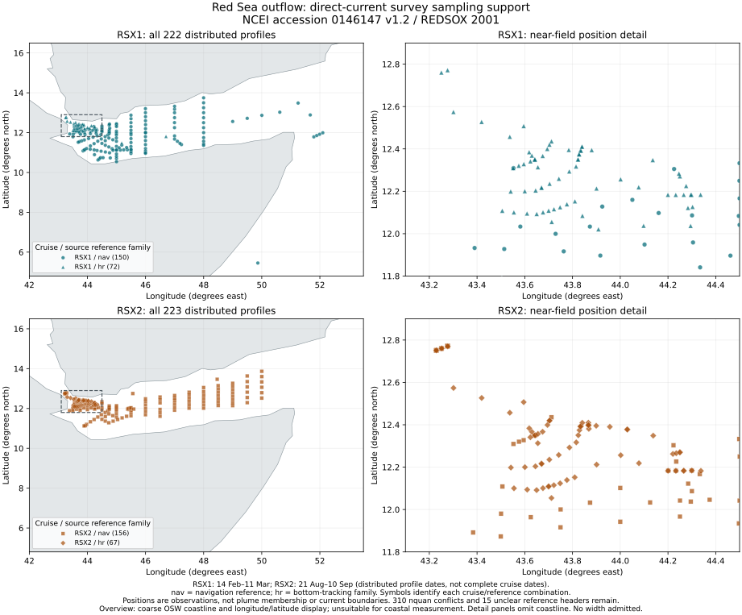

# Red Sea overflow: direct observations and reviewed source support

## What this batch fills

The previous Red Sea assessment had source-reported plume reaches and
editorial regional paths, with no original velocity/hydrography arrays.
This batch retains the full distributed ASCII LADCP and companion CTD
subsets from [NCEI accession0146147, version1.2](https://www.ncei.noaa.gov/archive/accession/0146147).
These provide the observations needed to investigate plume width, rather
than substitute the width of a bathymetric channel.

| Source | Profiles | Sample rows | Campaign split |
|---|---:|---:|---|
| Direct LADCP currents |445|42,004|222 winter /223 summer|
| Companion hydrography |461|441,183|237 winter /224 summer|

The906 files retain483,187 rows with exact individual SHA256 bindings.
Two deterministic ZIP archives preserve original bytes for offline use.
Cast locations, UTC support, reference families, vertical coverage,
missingness and source issues are catalogued. Source figures and authored
reports/quality notes are not redistributed.

This is source-data preparation and metadata reconciliation. Physical
current widths, annual extrema and footprints remain unadmitted; published
coverage remains149 scoped width records across79 names. No source is added
to the compiled query store by this preparation.

## Attribution and exact inputs

Peters, Hartmut; Bower, Amy; Johns, William (2017), *CTD, shipboard ADCP,
and lowered ADCP data from the Red Sea Outflow Experiment (REDSOX) and an
earlier Red Sea cruise in2001*, NCEI accession0146147, v1.2, ASCII LADCP and
CTD subsets. Accessed2026-10-18 UTC. NOAA metadata specifies public access;
retain source citation and archive use/distribution-liability conditions.
The versioned bundles contain numerical observations and source metadata.

Source root:
`https://www.ncei.noaa.gov/data/oceans/archive/arc0113/0146147/1.2/data/0-data/REDSOX/`

The [LADCP receipt](../research/source-data/ncei-redsox-2001/acquisition.json)
and [CTD receipt](../research/source-data/ncei-redsox-2001/ctd-acquisition.json)
retain URLs, original byte counts, individual checksums, acquisition times,
listing hashes and preflight hashes. The original source metadata and
documentation inspection are separate from transformed inventories.

LADCP preflightSHA256:
`334a989a2b2f5205d345584f8c471641bac3eea7be4a44ab360cb1881a855b41`.
CTD companion preflightSHA256:
`1230ece2b9c4869d76d94b9f2e751273f10cb9ddd2d3bdbe466408ae7c02a326`.
Both were saved before their respective profile acquisition, with every
listed file selected, irrespective of measured current or water properties.

The companion preflight anticipated the README's eight-column description.
Actual six/seven/eight-column schemas are retained and distinguished, rather
than forcing them into eight columns. The inherited velocity-quality rule
belongs to LADCP; it provides no CTD calibration error.

## Important source findings

- 310 LADCP headers declare12 variables, while their sequence and every
 observed row have4. Preserve the conflict; do not invent eight columns.
- 15 LADCP reference headers contain only `m`. Filenames distinguish306
 navigation-reference and139 bottom-tracking-family products, but do not
 establish those15 profiles' exact reference treatment.
- The winter author quality note summarizes average uncertainty near0.03m/s;
 the summer note tentatively gives0.04m/s and describes worse raw-data and
 shipboard-reference problems. Neither is a per-cast interval or width error.
 Source notes identify bad cast components; this is not an exhaustive quality
 admission review of every distributed profile.
- CTD has76 six-column,160 seven-column and225 eight-column profiles.
 Pressure is explicitly dbar.236 profiles have no depth column.225 depth
 headers use the typo `_z_dat_units`; keep that spelling visible. Sound-speed
 units printm/s² in all CTD headers; they are preserved, not silently corrected.
 No sound-speed analysis is performed.
- Three CTD header cast numbers disagree with filenames; six labels are empty
 or descriptive. One start timestamp is malformed and one latitude is
 invalid as decimal degrees. A filename join is insufficient verification.
- 444 LADCP profiles have a CTD filename match. Winter LADCP cast74 lacks a
 distributed CTD counterpart;17 CTD files lack a LADCP filename match.
 Absence from a distributed subset does not mean absence of current.

## Reviewed metadata layer

The [reconciliation ledger](../research/redsox-cruise-log-metadata-reconciliation.json)
binds13 affected profiles to exact raw-file hashes and visually reviewed
Appendix1 rows in the two archived cruise reports. It supplies9 reviewed
cast numbers,4 positions and1 cast-event time:14 fields across13 profiles.

| Evidence | Reviewed fields |
|---|---|
| Winter PDF11 | Cast2 number/position; cast3 event time; cast4/6/49 numbers |
| Winter PDF12 | Cast75/76 positions |
| Winter PDF14 | Cast194 position |
| Summer PDF8/9/10/11 | Cast14/82/165/166/177 numbers |

Winter cast75/76 CTD coordinates were truncated to43°E,12°N; published
degrees/minutes support the separate LADCP positions instead. Cast194's
latitude1108.13 is invalid as decimal degrees; the explicit log row supplies
11°08.13′N. Cast2 reuses cast1 header information; its separate log row,
later time and deeper pressure support establish a distinct cast context.

Original fields and raw issue counts remain intact. The derived
`reviewed_source_support` object explicitly names the authority, page, row,
converted position or reviewed number. The logs give positions to0.01arcminute;
decimal conversion does not add precision or establish a confidence interval.
The cast3 event time08:36UTC is **not** substituted for its unknown CTD start.
Unreviewed table rows are not presumed error-free: clipping and formatting
issues are visible elsewhere in the reports. Datum and full physical-cast
associations remain unverified; no pairing or interpolation is silently admitted.

## Visual and numerical access



The two campaigns have separate panels so summer points cannot obscure
winter sampling. Symbols and legend text distinguish reference families.
The dashed rectangle is a display viewport. Coarse OSW coastline is used
only in the overview; detail panels show source coordinate positions without
invented coastal precision. No points or connecting lines imply plume
membership, an observed current axis or current edges.

Full alternatives:
[LADCP inventory](../research/redsox-ladcp-source-inventory.json),
[CTD inventory and joins](../research/redsox-ctd-companion-inventory.json),
and the reconciliation ledger above. The SVG has a title and explicit
description. The diagram is static and supports scaling without motion.

## Reproduction and gates

Using the pinned `requirements-test.txt` environment:

```powershell
python analysis/build_redsox_ladcp_source_inventory.py
python analysis/build_redsox_ctd_companion_inventory.py
python analysis/build_redsox_ladcp_source_figure.py
python -m pytest analysis/test_redsox_ladcp_source_inventory.py analysis/test_redsox_ctd_companion_inventory.py analysis/test_indian_secc_eof_feasibility.py -q
```

All required numerical originals are versioned; default reproduction uses
no network. Source reports were acquired, pinned and visually inspected
locally; their exact URLs/hashes and reviewed pages remain in the ledger.
They are ignored originals, rather than new default remote fixture gates.

Executed candidate result: **33 tests pass in7.83s**. Checks exercise complete
source reproduction, wrapped units, source/observed column conflicts,
sentinels, invalid schemas/frames/counts, immutable provenance, pressure/depth
separation, reviewed positions, conflicting identities and event/start-time
separation. The final four-panel figure was visually inspected.

The separate baseline from clean663bae6 completed with **1573 tests and1061
subtests passing in2028.82s**. That result predates the new research tests.
The full gate for the combined branch is still required; no broader pass is
claimed by the33 focused checks.

## Next physical measurement work

Use reviewed cast identities/locations and source-defined transverse sections
to establish comparable vertical support and reference/tidal treatment.
Keep pressure and depth distinct, and select paired velocity edges supported
by observations on both sides. Compare hydrography without turning a salinity
band, channel width, survey span or cruise window into a current width.
The [Matt and Johns2007 methods](https://journals.ametsoc.org/view/journals/phoc/37/4/jpo2993.1.xml)
describe section-dependent tidal correction; indexed primary text was inspected,
but that article's original PDF has not been acquired. Two non-synoptic
campaigns cannot establish annual extrema or continuous seasonal geometry.

Work remains on the rolling branch and draft PR83. No new PR or main merge.
