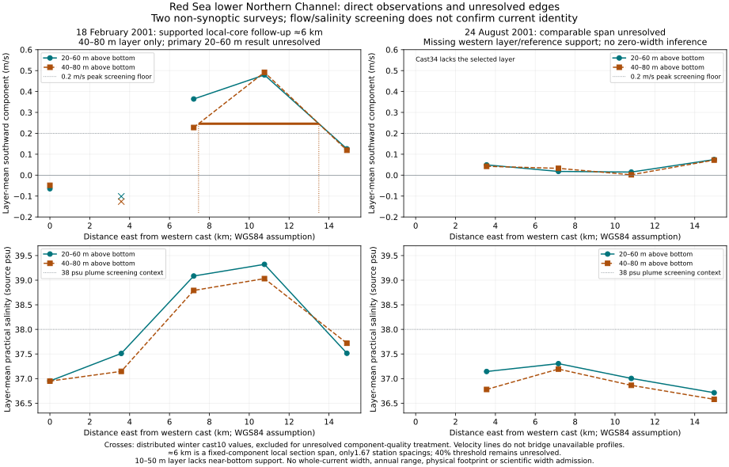

# Red Sea lower Northern Channel: observed local span and unresolved edges

## Result

The winter observations support a **roughly6km local half-peak southward
component span in the predeclared40–80m-above-bottom layer**. Both crossing
brackets use only casts7,8,9, with interpretable source references. This is a
supported-local-core follow-up, not the declared primary layer result or a
verified global section maximum.

The primary20–60m layer remains unresolved without quality-questioned cast10.
Using its distributed values conditionally gives about7.3km, but that value
does not replace the primary unknown. The matched summer survey lacks
comparable usable support. No whole-current width, physical annual range,
flow-normal width, current footprint, canonical rank or new inventory width
record is admitted. Published coverage remains149 scoped records/79 names.

| Winter40–80m supported local core | Result |
|---|---|
| Half-peak fixed southward-component span | About6km; unrounded6.034865km retained for reproduction |
| Source casts used by the two brackets |7,8,9; no cast10 value used |
| Core southward component | About0.49m/s |
| Core layer salinity | About39.03 sourcepsu |
| Span / median native station spacing |1.67; resolution review required |
| Core vector / section-normal obliquity | About15.7°; no cosine correction applied |
|40% peak threshold | Unresolved: needs excluded cast10 |
|60% peak threshold | About4.8km; different boundary choice, not a width error |
| Uniform±0.03m/s perturbation at50% | About5.7–6.4km; finite scenario, not a confidence interval |

No combined uncertainty interval is formed from incomplete threshold,
vertical-layer, sampling and reference scenarios. Boundary coordinates and
their original neighboring-station brackets remain in the numerical output.
The near-bottom10–50m layer lacks endpoint support in both surveys; no
extrapolation to the sea floor supplies its missing observations.

## Prospective choices and later implementation clarification

The [winter preflight](../research/source-data/redsox-lower-nc-2001/lower-northern-channel-section-preflight.json)
was frozen after metadata/geography review and before the selected-profile
layer/span computations. Earlier format inspection had incidentally exposed
three tail rows of cast10, so the declaration's original wording about no
selected values having been seen is too strong. The original bytes are
preserved alongside a [declaration-history qualification](../research/source-data/redsox-lower-nc-2001/declaration-history-note.json).
This is not a fully blinded preregistration. The rules fix casts7–11 near12.183°N on18February2001, the20–60m
primary and10–50/40–80m sensitivity layers, fixed southward component,0.2m/s
peak floor,0.5 boundary fraction,0.4/0.6 scenarios and complete-data rules.
The [matched-survey follow-up preflight](../research/source-data/redsox-lower-nc-2001/matched-section-followup-preflight.json)
was also declared before the layer/span computations. It selects summer casts30–34
from corresponding station neighborhoods, retaining the same operators.
Its±0.04m/s scenario uses the separate summer quality context.

The first implementation treated *any* missing profile as a reason to reject
the entire section, even beyond already observed crossings. That conservative
primary output is preserved. A separate, explicitly later
[implementation clarification](../research/source-data/redsox-lower-nc-2001/implementation-clarifications.json)
applies the existing project's largest-supported-peak/missing-before-crossing
operator. It produces the40–80m local-core diagnostic while keeping global
peak search incomplete. It is not falsely described as the initial primary
result or a fully prospective analysis. The unavailable cast is never filled
or interpolated across.

## Sources, vertical calculation and quality

All numerical inputs are the checksum-pinned NCEI0146147v1.2 ASCII LADCP and
CTD archives already retained in the source-inventory batch. The builder
revalidates every original input and the exact declaration hashes. Original
observations, source quality exclusions and conditional calculations are
separate fields.

Integrate paired earth-coordinate velocity over the actual reported heights
using in-range endpoint interpolation and trapezoidal integration. Require
three original paired layer samples and no source gaps above20m. Never bridge
missing samples, extend endpoints or reorder a nonmonotonic source profile.

When CTD lacks an explicit depth column, use `-gsw.z_from_p(p,lat)` with
GSW3.6.23 and default zero dynamic-height/geopotential terms. Pressure remains
dbar and depth remains metres; the conversion is labelled as derived. The
[official TEOS-10 documentation](https://www.teos-10.org/pubs/gsw/html/gsw_z_from_p.html)
defines ocean height as negative. Interpolate salinity only within complete
native support at the velocity-layer depths. The38psu/0.2m/s screens are
editorial checks, not independently verified current identity.

Cast10 has `tag=upf`; the author quality note rejects its downcast. The only
two winter `upf` tags correspond to the two rejected downcasts, but tag naming
and an undocumented `up=0` field do not independently verify the distributed
component treatment. It stays excluded from the primary/local-core input.

Summer cast34 has `reference=m`, a nonmonotonic height axis and a lowest
reported height above395m. It cannot support the selected20–80m layers.
No replacement height, velocity, bottom depth or missing edge is invented.
The remaining usable summer casts are not sufficient to establish a full
section maximum, paired plume width or a zero/absent current.

## Alternate-format probe

The two [MATLAB counterpart receipts](../research/source-data/redsox-lower-nc-2001/alternate-format-acquisition.json)
retain exact URLs, byte counts and SHA256 values. These are alternate archived
products, not equivalent serializations: winter10 has116 versus58 samples
and different values; summer34 retains `reference=m` and has different values
despite the same row count. The inspected winter MATLAB header describes its
full12-column product; this explains context for that cast's retained `nquan12`
in the reduced ASCII, without claiming that every one of310 cases is resolved.
Neither alternate product replaces the scientific inputs.

Optional probe, requiring SciPy1.17.1 and NumPy2.4.1:

```powershell
python analysis/check_redsox_alternate_source_formats.py
```

## Figure and reproduction



Solid circles and dashed squares distinguish layers without color. Crosses
show distributed but excluded winter cast10 values. Velocity lines do not
bridge unavailable velocity profiles. All six layer/survey cases and all
54 conditional plus54 supported-local-core scenarios, including nulls, are
in the [numerical output](../research/redsox-lower-nc-dated-section-diagnostic.json).

Using pinned `requirements-test.txt`, offline:

```powershell
python analysis/build_redsox_lower_nc_section.py
python analysis/build_redsox_lower_nc_figure.py
python -m pytest analysis/test_redsox_lower_nc_section.py -q
```

Executed:9 focused tests pass in2.15s; alternate-format probe executed; final
figure visually inspected. Tests cover actual-coordinate integration, missing
support, no extrapolation, gaps, missing-before-crossing, separate conservative
and local outputs, tied peaks, original-source reproduction, the official
TEOS-10 pressure-conversion example and all nulls.
The independent1606-test baseline at24cc05e remains running; its outcome is
not claimed for this later candidate. Work stays in draft PR83, without a
new PR or main merge.

## Next admission work

Register this as diagnostic evidence, preserving its primary/follow-up
distinction and source records. Establish source component/reference treatment,
section-specific tides, independent association and adequate transverse
resolution before physical width admission. Recover compatible repeated
sections before a seasonal or annual width range. Keep incomplete evidence
visible rather than averaging away missing scenarios.
