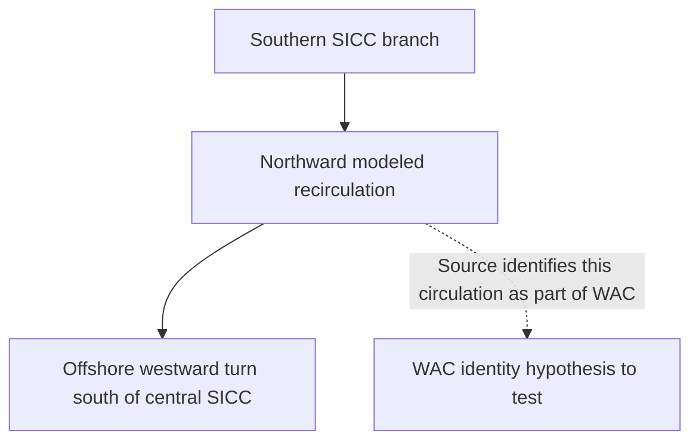

# West Australian Current: identify the corridor before measuring an axis

The remaining WAC length gap needs a source-consistent flow identity. Numerical
connection between the existing 36°S and 28°S gates is insufficient. Preserve the
earlier conditional traces as numerical research, without treating either their
successes or failures as evidence of a physical whole-current axis.

The [2018 primary study](https://doi.org/10.1029/2017JC013221), sections 3.2.2–3.2.3
and 4, describes modeled recirculation from the southern South Indian Countercurrent
branch northward and then offshore, south of the central branch. Its discussion
acknowledges uncertainty in locating the WAC. This gives a source-specific pathway
to investigate, rather than establishing a unique current axis.

This diagram represents the author's model interpretation. It has no geographic
coordinates or scale and does not establish canonical branch membership.

The companion [source constraints](../research/west-australian-wijeratne-2018-pathway-constraints-v1.json)
retain the two regional section intervals, their different depth support, and
the published transport context. Neither longitude interval is admitted as a
physical width. Their differences cannot establish seasonal variation.

Original Figures 6 and 10 have now been visually reviewed (PDF pages 11 and 16;
printed 3454 and 3459). Figure 6 is explicitly schematic. Figure 10 maps cumulative
transport in Sv, not velocity. Its contours cannot supply a current centerline or
width edges. The x1 latitude differs between prose (22°S) and panel d (22.5°S);
retain that source conflict without choosing an endpoint.

Proceed in this order:

1. Seek velocity-based support for the northward-to-offshore corridor. Distinguish
   northward Flinders/sSICC supply from the recirculation identified with WAC.
   Do not digitize Figures 6 or 10 as axes, or merge the 1977 narrow cyclonic-stream
   convention with this one.
2. Specify the intended quantity: an author-described regional pathway,
   a thresholded model-flow corridor, or a physical full-current axis. Each needs
   separate labels and evidence; a regional reference route can remain partial.
3. Choose compatible time and depth support before defining interfaces. The
   source's 0–300 m and full-depth section results are different quantities.
   SICC inflow maxima and section coordinates are context, not axis endpoints.
4. Only after corridor identity is supported, propose source-backed interface
   gates and evaluate tracing or corridor diagnostics. Any new field processing
   requires its own cloud scope under the existing one-job sequence constraint.
5. Admit a length with named endpoints, method, spatial scope and uncertainty.
   Keep missing whole-current and seasonal dimensions explicit. Add atlas/query
   presentation and verify it before updating installed coverage counts.

This source review changes the next action, not the measurement totals. The
installed coverage checkpoint remains v6. No build, browser run, field-processing
job, installation or main merge is authorized by this document.
